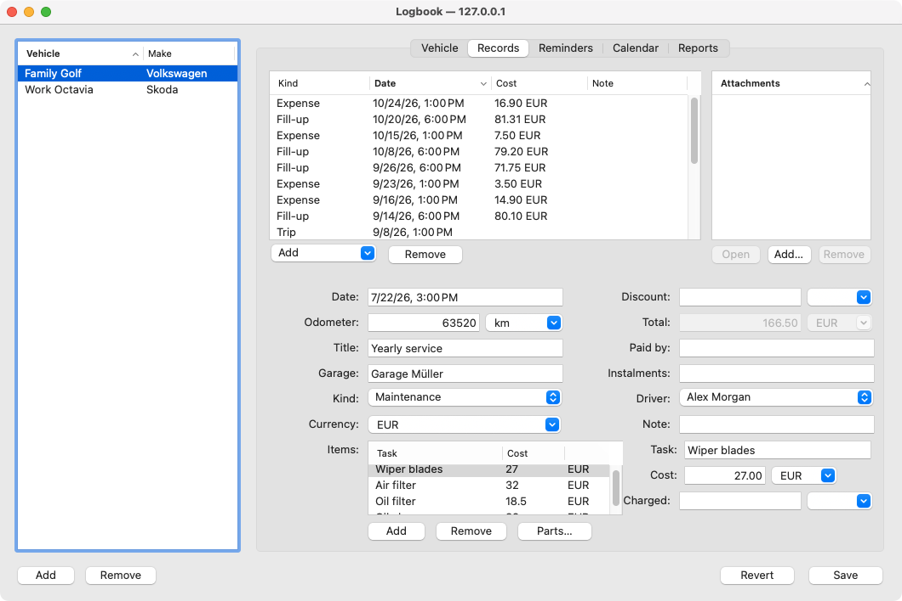
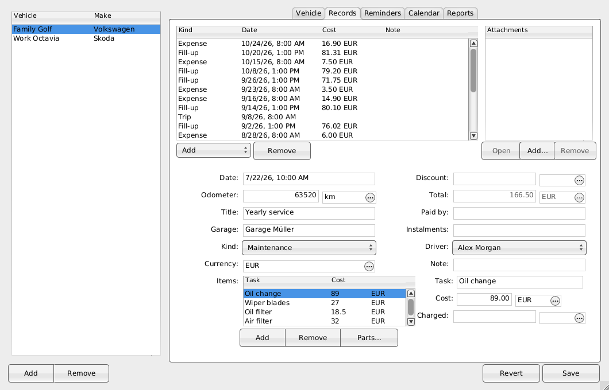
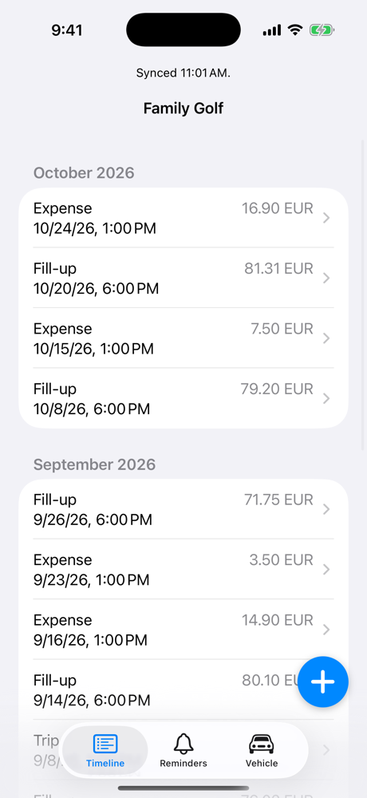
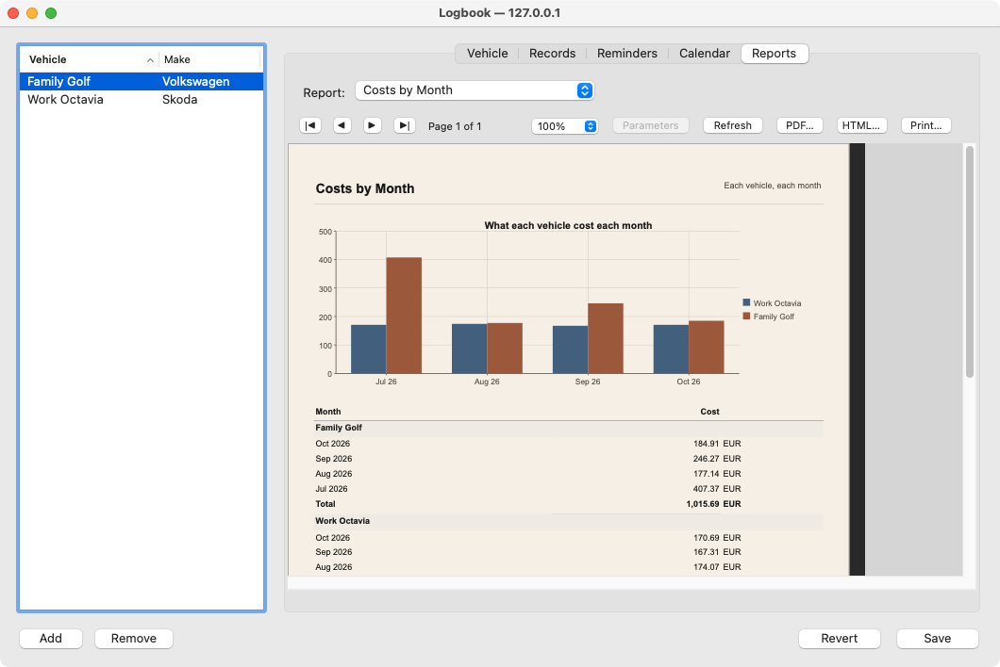
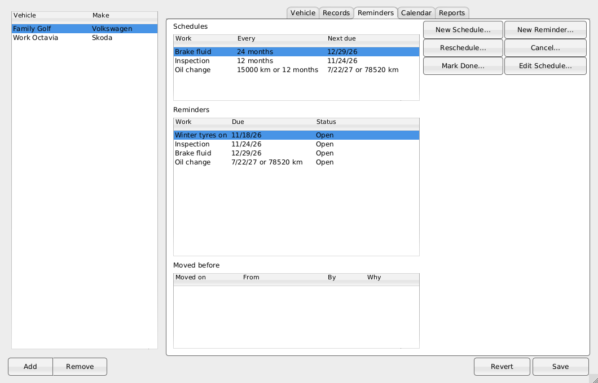
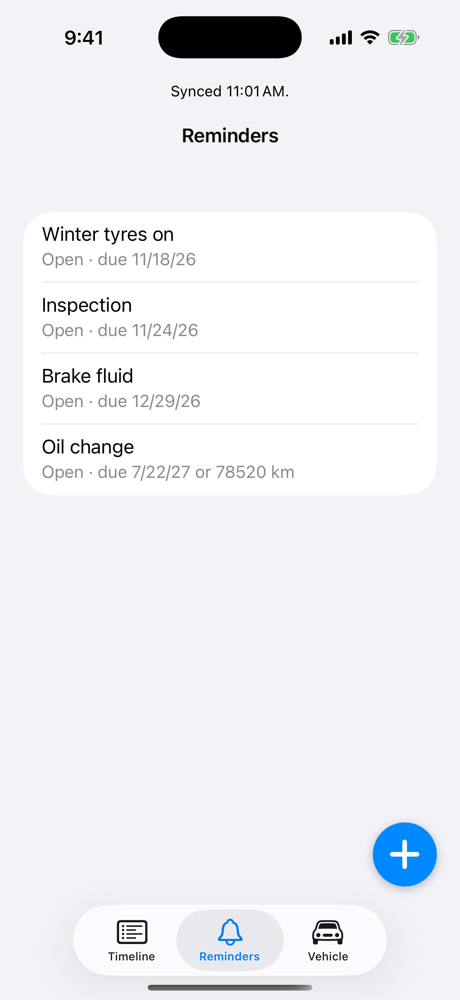
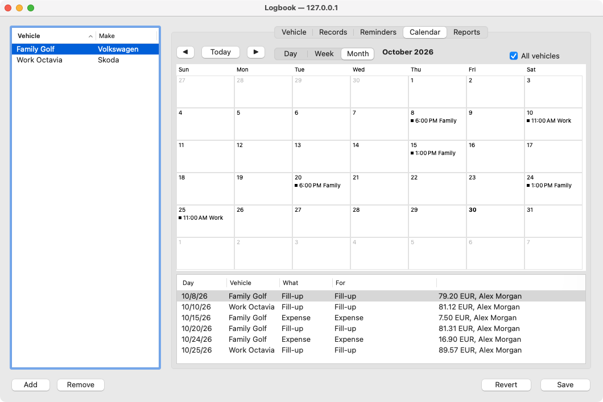
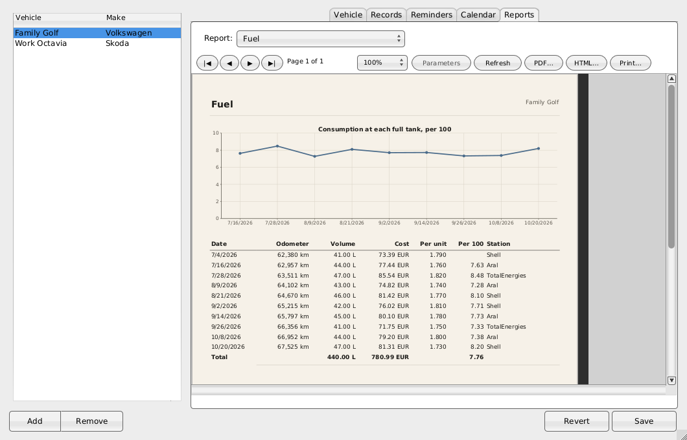
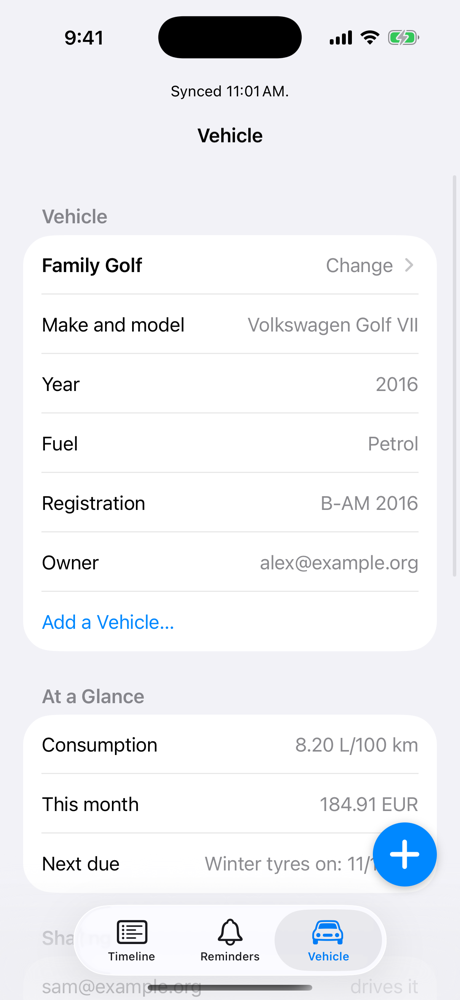
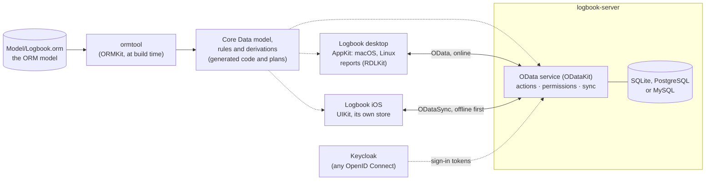

# Logbook

**A car logbook for the people who share a car: what each vehicle needs
and when, what was done to it, and what it cost, kept on a server of your
own and in your pocket.**

Log a fill-up at the pump from your phone, offline if need be; the
service, the parking and the insurance from your desk. Logbook works out
the consumption, what the car costs each month and when the next oil
change is due, by date or by distance, whichever comes first, and closes
that reminder when the garage's bill says the oil was changed. Share a
car with the family by email: everyone logs, the owner decides.

| macOS | Linux (GNUstep) | iOS |
|:---:|:---:|:---:|
|  |  |  |
|  |  |  |
|  |  |  |

## Get it

From [Releases](https://github.com/ashalkhakov/LogBook/releases/latest):

| Platform | Download | Contains |
|---|---|---|
| macOS 14+ | `Logbook-macOS-*.zip` | The desktop app, signed and notarized |
| Linux x86_64 | `Logbook-*.AppImage` | The desktop app, and the server (`… --server`) |
| iOS | `Logbook-*-unsigned.ipa`, `Logbook-Simulator-*.zip` | Unsigned: sign the `.ipa` yourself to put it on a phone; the zip runs in the iOS Simulator |

Every push also uploads unsigned builds to its
[Actions run](https://github.com/ashalkhakov/LogBook/actions). The apps
talk to a `logbook-server`: run the AppImage's
(`./Logbook-*.AppImage --server -StoreURL logbook.sqlite -Port 8080`), or
build one ([docs/SERVER.md](docs/SERVER.md), signing in with Keycloak
included).

Build from source:

    make -f Makefile.apple && make -f Makefile.apple check     # macOS and iOS
    make && make check                                          # Linux (GNUstep)

Details: [docs/BUILDING.md](docs/BUILDING.md).

## What it does

- **Every kind of record** a car has: fill-ups (volume, cost, station, a
  full tank or not), services and their items, expenses of kinds of your
  own, trips and the income they made, tyre sets and changes, inspections
  against a checklist, documents with their expiry, meter readings; photos
  of receipts on any of them.
- **Schedules and reminders**: every 15,000 km or 12 months, from the last
  time it was done. The service that does the work closes the reminder and
  makes the next, whichever device logs it; a reminder can be moved,
  cancelled and replaced, or done by hand.
  ([docs/PROCESSES.md](docs/PROCESSES.md))
- **A calendar** of a car's day, week or month, or of all of them: what
  was done, what is due, what the schedules plan.
- **Reports**: costs by month across the cars, fuel and consumption at each
  full tank, the logbook itself; to PDF, HTML or the printer.
- **Sharing**: a car is its owner's; the drivers it is shared with log
  their fill-ups and services, and see only the cars they drive.
- **Offline on the phone**: the iOS app keeps its own copy and syncs it
  when it can; a record changed on both sides comes back as a conflict to
  settle, keep theirs, keep mine, or edit.
  ([docs/IOS.md](docs/IOS.md))
- **Stock** for a workshop's parts: catalogs, items and kits, purchase and
  sale orders received and shipped in parts, counts and adjustments; parts
  fitted in a service come off the shelf.
  ([docs/STOCK.md](docs/STOCK.md))
- **The rules hold everywhere**: the odometer does not go backwards, a
  trip does not end before it began, a tyre change removes the set that
  was fitted. The phone, the desktop and the server check the same rules
  before saving, and say what is wrong in plain words.

## Architecture

One model, from which the build generates what every part runs.

- **The model** is `Model/Logbook.orm`: the facts about cars and what is
  done to them, stated as sentences, with their rules, designed by
  Halpin's conceptual schema design procedure ([docs/CSDP.md](docs/CSDP.md)).
  [ORMKit](https://github.com/ashalkhakov/ORMKit)'s `ormtool` generates
  the Core Data model and the code that keeps its rules, so nothing of it
  is written twice. Open it in ORMDesigner to see the diagrams.
- **The procedures** (`Shared/LBProcedures.h`) are what happens to a
  reminder: started, done, moved, cancelled. They run in the server, as
  OData actions, and in the phone's own store, alike; what they make is
  named by what it is made of, so two devices doing the same offline make
  the same objects.
- **The server** is [ODataKit](https://github.com/ashalkhakov/ODataKit)'s
  service over Core Data (Apple's, or
  [FreeCoreData](https://github.com/ashalkhakov/FreeCoreData) on Linux),
  with who may do what in `Server/Logbook.permissions.plist`.
- **The apps**: the desktop app works against the server, online; the
  iOS app keeps a store of its own and syncs it with ODataSync. The
  desktop's reports are [RDLKit](https://github.com/ashalkhakov/RDLKit)'s.

## Limitations

- **The desktop app needs the server**: it does not work offline (the
  phone does).
- **No Windows build yet**, and no Android app.
- **iOS**: unsigned, no App Store or TestFlight build; the icon is a
  placeholder. Managing and reporting stay with the desktop app.
- **The Mac app does not update itself** yet.
- Early days: the data model is settled, the apps are still growing.

## More

- [docs/BUILDING.md](docs/BUILDING.md): building, the checks, the model's
  generation, Xcode.
- [docs/SERVER.md](docs/SERVER.md): running the server, signing in,
  permissions.
- [docs/IOS.md](docs/IOS.md): the iOS app.
- [docs/PROCESSES.md](docs/PROCESSES.md): what happens to reminders, and
  offline.
- [docs/STOCK.md](docs/STOCK.md): stock control.
- [docs/CSDP.md](docs/CSDP.md): how the model was designed.

## Licence

Logbook is free software, released under the GNU General Public License,
version 3 ([LICENSE](LICENSE)).
